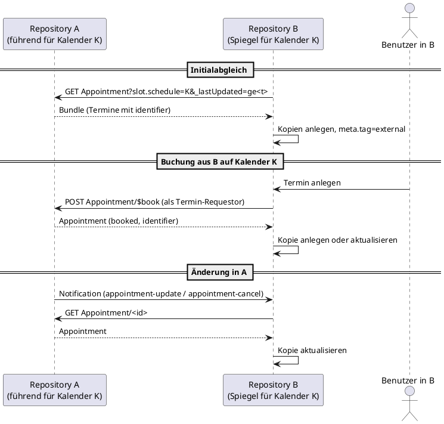

# ADR: Mehrere Termin-Repositories innerhalb eines Krankenhauses – Hoheit und Synchronisation von Terminen

Datum: 2026-11-04  

Status: Vorgeschlagen  

Ticket: PTDATA-2398 (Vorgänger: PTDATA-1977, PTDATA-2004)

## Kontext

### Ausgangssituation

Der IG Terminplanung definiert die Akteure Termin-Repository, Termin-Requestor und Termin-Consumer. Normative Festlegungen gelten ausschließlich für das Termin-Repository ([Akteure](https://gemspec.gematik.de/ig/fhir/isik/terminplanung/6.0.0/Akteure.html)). Die Seite [Architekturoptionen](https://gemspec.gematik.de/ig/fhir/isik/terminplanung/6.0.0/Architekturoptionen.html) beschreibt zwei beispielhafte Architekturen:

1. **KIS als terminführendes System**: Das KIS ist Termin-Repository, das Patientenportal ist Termin-Requestor und Termin-Consumer.
2. **Patientenportal als terminführendes System**: Das Patientenportal führt eigene Kalender und bucht direkt. Das KIS ist "weiterhin auch als Termin-Repository zu betrachten, da Kapazitäten der Leistungserbringer hier vorgehalten werden". Der IG schließt mit dem Satz: "Eine bidirektionale Synchronisierung des Patientenportals und des KIS müsste bei dieser Variante fortlaufend durchgeführt werden."

Zu dieser Synchronisierung trifft der IG keine weitere Aussage. Das zugehörige Schaubild "Übersicht Akteure (2)" (`Material/Terminplanung/Übersicht Termin Akteure (2).drawio.png`) zeigt zwei Termin-Repositories (internes Terminmanagement-System und externes terminführendes System), die über einen bidirektionalen Pfeil verbunden sind, ohne dass diesem Pfeil eine Interaktion zugeordnet ist. Einziger weiterer Hinweis ist die Anmerkung zu Interaktion 5 ([Interaktionen](https://gemspec.gematik.de/ig/fhir/isik/terminplanung/6.0.0/Interaktionen.html)): "Es ist zu beachten, dass innerhalb dieser Aktion ein terminführendes Termin-Repository die Rolle des Termin-Requestors übernehmen kann und den neu-angelegten Termin in ein weiteres Termin-Repository spiegelt."

### Auslöser

Im Dezember 2025 fragte ein Portalhersteller an (PTDATA-1977), welches System in Variante 2 Termin-Repository bzw. Termin-Requestor ist, ob die Interaktionen auch für diese Variante gelten, welche Interaktion für die Synchronisierung zu nutzen ist und was "terminführend" bedeutet. Die interne Antwort lautete sinngemäß: Terminführend ist das System, in dem die Source of Truth für Kalender und Termine liegt. Beide Systeme können beides sein. Für die Synchronisierung gelten die definierten Interaktionen, insbesondere `$book`. Diese Klarstellungen wurden nicht in den IG übernommen (PTDATA-2004 abgebrochen).

Über den Fall Patientenportal hinaus ist die Situation mehrerer Termin-Repositories in einem Krankenhaus eher Regel als Ausnahme: Radiologie (RIS), Funktionsdiagnostik, OP-Planung, Physiotherapie oder ein angeschlossenes MVZ führen häufig eigene Terminkalender in eigenen Systemen, während das KIS die Kontakte und einen Teil der Kalender hält.

### Problemstellung

Die folgenden Punkte sind im IG nicht geregelt und führen bei Herstellern und Krankenhäusern zu unterschiedlichen Auslegungen:

1. **Begriff "terminführend"** wird verwendet, aber nicht definiert. In Variante 2 sind zudem beide Systeme Termin-Repository mit überlappender Verantwortung (Portal bucht direkt, KIS hält Kapazitäten).
2. **Granularität der Hoheit**: Es ist offen, ob die Hoheit über Termine systemweit, je Kalender (Schedule) oder je Termin (Appointment) gilt.
3. **Mechanismus der Synchronisation**: Richtung (uni- oder bidirektional), Auslöser (Push per Subscription oder Pull per Suche), zu verwendende Interaktionen, Verhalten bei Konflikten (Doppelbuchung, konkurrierende Änderung), Initialabgleich und Wiederaufsetzen nach Ausfall.
4. **Identität eines Termins über Systemgrenzen**: `Appointment.id` ist serverlokal. `Appointment.identifier` ist in ISiKTermin nicht profiliert (kein Must Support). Eine Korrelation gespiegelter Termine ist damit nicht interoperabel möglich.
5. **Referenzen in Kopien**: Ein gespiegelter Termin referenziert `slot`, `participant.actor` (Patient, Practitioner, Location) des führenden Systems. Diese Referenzen sind im Zielsystem nicht ohne Weiteres auflösbar.
6. **Rollenwiderspruch**: Der Termin-Requestor ist definiert als System "ohne permanente Persistierung". Ein Termin-Repository, das laut Interaktion 5 "die Rolle des Termin-Requestors übernimmt", widerspricht dieser Definition.
7. **Konformität**: Es ist offen, ob und in welchem Umfang eine Repository-zu-Repository-Synchronisation Gegenstand des Bestätigungsverfahrens sein soll. Das Verfahren prüft bisher ausschließlich die Serverseite des Termin-Repositories.

### Randbedingungen und Annahmen

- Der IG stellt bereits alle technischen Bausteine bereit, die für eine Synchronisation benötigt werden: `$book` (inkl. erneuter Aufruf unter Beibehaltung der `id` bei Verschiebung, asynchrone Ausführung, Status `pending`), PATCH auf Appointment, Suche auf Appointment, Slot und Schedule inkl. `_lastUpdated`, Subscriptions mit den Topics `appointment-update` und `appointment-cancel` (Profil ISiKSubscriptionTermin, verpflichtende Rolle gemäß ADR-002) sowie den generischen Topics `Resource/Appointment`, `Resource/Slot`, `Resource/Schedule`, das Tag `external` aus `common-meta-tag-de` in `ISiKTermin.meta.tag` zur Kennzeichnung extern erstellter Ressourcen, die Anlage von Patient-Ressourcen gemäß Basismodul sowie das Topic `patient-merge`.
- Das Bestätigungsverfahren kann Client-Verhalten (Requestor, Subscriber) nicht prüfen. Normative Vorgaben an Clients sind formulierbar, aber nicht zertifizierbar.
- Stufe 6 ist weitgehend abgeschlossen. Änderungen für Stufe 6 müssen klein und nicht-breaking sein. Neue normative Anforderungen sind ein Thema für Stufe 7.
- Die Entscheidung muss mit den Stakeholdern (KIS- und Portalhersteller, Krankenhäuser) abgestimmt werden (Follow-up gemäß Ticket).

## Optionen

### Option 1: Status quo mit Scope-Ausschluss

Der IG stellt klar, dass die Synchronisation zwischen mehreren Termin-Repositories nicht Gegenstand von ISiK ist. Variante 2 der Architekturoptionen wird um einen entsprechenden Hinweis ergänzt oder gestrichen.

- PRO:
  - Kein Spezifikations- und Implementierungsaufwand.
  - Keine Erweiterung des Bestätigungsverfahrens.
- CON:
  - Die Herstellerfrage bleibt unbeantwortet. Hersteller und Krankenhäuser lösen das Problem proprietär, was dem Ziel von ISiK widerspricht.
  - Die Rollenverteilung in Variante 2 bleibt unscharf, der Rollenwiderspruch (Punkt 6) bleibt bestehen.
  - Das Schaubild "Übersicht Akteure (2)" suggeriert weiterhin eine spezifizierte Repository-zu-Repository-Beziehung.

### Option 2: Architekturprinzip "Kalenderhoheit" und nicht-normative Leitlinie auf Basis bestehender Interaktionen

Der IG definiert das Prinzip der Kalenderhoheit und beschreibt nicht-normativ, wie mehrere Termin-Repositories mit den vorhandenen Interaktionen konsistent gehalten werden. Es werden keine neuen Profile, Operationen oder Rollen eingeführt.

Prinzipien:

- **P1 Kalenderhoheit**: Für jeden Kalender (Schedule) und die darin enthaltenen Terminblöcke (Slot) gibt es genau ein führendes Termin-Repository. Termine, die Terminblöcke dieses Kalenders belegen, werden ausschließlich im führenden Repository angelegt, geändert und abgesagt. "Terminführend" wird damit nicht system-, sondern kalenderbezogen definiert. Ein System kann für einen Teil der Kalender führend und für andere Kalender nur Spiegel sein. Variante 2 löst sich damit auf: Portal und KIS sind beide Termin-Repository, jeweils für ihre eigenen Kalender. Eine überlappende Hoheit zweier Systeme über dieselbe Ressource (z.B. denselben Behandlungsraum) wird nicht unterstützt.
- **P2 Schreibpfad nur über das führende Repository**: Ein System, das einen Termin auf einem fremden Kalender anlegen, verschieben, ergänzen oder absagen will, tritt gegenüber dem führenden Repository als Termin-Requestor auf und nutzt `$book` (Neubuchung, Verschiebung), PATCH (Absage, Zusatzinformationen) und die Patientenanlage gemäß IG. Es schreibt nicht zuerst in die eigene Kopie.
- **P3 Lesepfad und Spiegelung**: Andere Repositories dürfen fremde Termine als Kopie vorhalten (Anzeige, Ressourcenplanung, Kontaktvorbereitung). Kopien werden ereignisgesteuert über Subscription (`appointment-update`, `appointment-cancel`, alternativ `Resource/Appointment`) aktualisiert. Der Initialabgleich und das Wiederaufsetzen nach Ausfall erfolgen per Suche, z.B. `Appointment?_lastUpdated=ge<Zeitpunkt>` oder `Appointment?slot.schedule=<Schedule>`. Nach einer Benachrichtigung wird die Ressource beim führenden Repository erneut gelesen (Vorgehen gemäß ISiK Subscription IG).
- **P4 Identität**: Das führende Repository vergibt `Appointment.identifier` (Business Identifier). Kopien übernehmen diesen Identifier unverändert und sind damit systemübergreifend korrelierbar. Kopien tragen `meta.tag` = `external` aus `common-meta-tag-de`. Die Angabe des Ursprungssystems in `meta.source` wird empfohlen.
- **P5 Konflikte**: Das führende Repository ist autoritativ. Kopien lösen keine Konflikte auf. Eine Schreibanfrage auf eine Kopie wird vom spiegelnden System zurückgewiesen (OperationOutcome) oder an das führende Repository weitergeleitet. Der Slot-Status liegt ausschließlich im führenden Repository. Zwischen Ereignis und Aktualisierung der Kopie besteht Eventual Consistency.
- **P6 Patientenidentität**: Der Patient muss in beiden Systemen auflösbar sein. Es gelten die bestehenden Festlegungen zur Übergabe bzw. Anlage einer Patient-Ressource. Das Topic `patient-merge` ist von spiegelnden Systemen zu berücksichtigen.
- **P7 Kapazitäten**: Hält ein System Kapazitäten (Schedule, Slot) für Ressourcen, deren Kalender ein anderes System führt, so sind diese Kapazitäten entweder nicht buchbar (Kopie per `Resource/Schedule` und `Resource/Slot`) oder die Kalender sind disjunkt aufgeteilt.

Notwendige Änderungen am IG:

- Architekturoptionen: Definition "terminführend", Neufassung von Variante 2 entlang P1 bis P7, Austausch des Schaubilds "Übersicht Akteure (2)" durch ein Schaubild mit Kalenderhoheit und Zuordnung der Interaktionen zum Pfeil zwischen den Repositories.
- Akteure: Klarstellung, dass die Rollen Termin-Requestor und Termin-Consumer je Interaktion vergeben werden und ein Termin-Repository gegenüber einem anderen Repository diese Rollen einnehmen kann. Die Aussage "keine permanente Persistierung" bezieht sich auf die Daten der jeweiligen Interaktion, nicht auf das System.
- Interaktionen: Hinweis bei Interaktion 5, 6, 7 und 8 auf P2 und P3.
- ISiKTermin: `identifier` als Must Support (Stufe 7, da neue Anforderung) oder zunächst als SOLL-Empfehlung im Text.

Bewertung:

- PRO:
  - Beantwortet die Herstellerfrage vollständig und konsistent mit der internen Antwort aus PTDATA-1977.
  - Keine neuen Profile, Operationen oder Rollen. Alle Bausteine existieren, die Subscription-Pflicht aus ADR-002 ist die Voraussetzung für den ereignisgesteuerten Lesepfad.
  - Für Stufe 6 als rein redaktionelle Änderung umsetzbar.
  - Vermeidet das Konfliktproblem durch Design (ein Schreiber je Kalender) statt durch Konfliktauflösung.
- CON:
  - Nicht-normativ und damit nicht testbar. Interoperabilität entsteht nur, wenn Hersteller der Leitlinie folgen.
  - Ohne `identifier` als Must Support bleibt die Korrelation (P4) eine Empfehlung.
  - Setzt voraus, dass Krankenhäuser die Kalenderhoheit organisatorisch eindeutig zuweisen. Szenarien mit gemeinsam genutzten Ressourcen über mehrere führende Systeme werden ausgeschlossen.
  - Aufgelöste Referenzen in Kopien (Slot, Practitioner, Location) bleiben ein Implementierungsthema des spiegelnden Systems.

### Option 3: Normative Rolle "Termin-Synchronisation" am Termin-Repository

Die Prinzipien aus Option 2 werden als eigene, optionale Rolle am Akteur Termin-Repository normativ gefasst (analog zur Rolle Termin Subscription aus ADR-002), mit eigenem CapabilityStatement.

Mögliche Festlegungen:

- Das Repository MUSS `Appointment.identifier` vergeben, bei Kopien übernehmen und die Suche `Appointment?identifier=` unterstützen.
- Kopien MÜSSEN mit `meta.tag` = `external` gekennzeichnet sein. Schreibzugriffe auf Kopien MÜSSEN mit HTTP 422 und OperationOutcome zurückgewiesen werden.
- Das Repository MUSS als Subscriber die Topics `appointment-update` und `appointment-cancel` sowie den Resync per `_lastUpdated` unterstützen.
- Das Repository MUSS als Requestor `$book` und PATCH gegenüber einem anderen Repository ausführen können.

- PRO:
  - Interoperable, in Teilen testbare Synchronisation. Die Serverseite (identifier-Suche, Kennzeichnung, Zurückweisung) ist im Bestätigungsverfahren prüfbar.
  - Klare Produktanforderung für KIS- und Portalhersteller.
- CON:
  - Client-Verhalten (Subscriber, Requestor) ist nicht zertifizierbar, ein Teil der Rolle bleibt deklarativ.
  - Erheblicher Spezifikations- und Abstimmungsaufwand, nicht für Stufe 6 geeignet.
  - Erhöht den Umsetzungsaufwand für Repositories, auch für solche, die in der Praxis nie spiegeln.
  - Erfordert vorab eine Stakeholder-Entscheidung zu Option 2, da Option 3 auf denselben Prinzipien aufbaut.

### Option 4: Fassade statt Synchronisation

Je Krankenhaus wird genau ein ISiK-Termin-Endpunkt angeboten (KIS oder Integrationsplattform), der Anfragen anhand von Schedule bzw. HealthcareService an das jeweils führende System weiterleitet. Termine existieren genau einmal, es gibt keine Kopien.

- PRO:
  - Keine Replikation, keine Konflikte, kein Identitätsproblem.
  - Für Termin-Requestor und Termin-Consumer vollständig transparent, die bestehenden Festlegungen gelten unverändert.
- CON:
  - Die Routing-Komponente liegt außerhalb des ISiK-Scopes, der Aufwand verlagert sich in die Integrationsschicht des Krankenhauses.
  - Systemübergreifende Sichten (alle Termine eines Patienten) erfordern Aggregation zur Laufzeit, Performance-Kategorien sind schwer einzuhalten.
  - Setzt ebenfalls die Kalenderhoheit (P1) voraus und ist damit keine Alternative zu Option 2, sondern eine Deployment-Variante davon.

### Option 5: Generische bidirektionale Master-Master-Synchronisation

Der IG spezifiziert, wie zwei Repositories dieselben Kalender gleichberechtigt führen und Änderungen wechselseitig abgleichen.

- PRO:
  - Entspricht dem Wortlaut der aktuellen Variante 2 ("bidirektionale Synchronisierung").
- CON:
  - Erfordert Konfliktauflösung (konkurrierende Buchung desselben Slots, Verschiebung in beiden Systemen), Reservierungs- oder Sperrprotokolle und Versionsabgleich. Dafür gibt es in FHIR R4 REST und in ISiK keine Grundlage, auch die bekannten Scheduling-Profile von HL7 (Argonaut Scheduling) und IHE basieren auf Requestor-Server-Modellen ohne Repository-zu-Repository-Abgleich.
  - Doppelbuchungen sind ohne verteiltes Locking nicht ausschließbar, das Risiko trägt der Patient.
  - Spezifikations- und Implementierungsaufwand stehen in keinem Verhältnis zur Zahl realer Einsatzfälle (vgl. Einschätzung in PTDATA-1977: "praktische Relevanz teilweise gering").

Diese Option wird verworfen.

### Gegenüberstellung

| Kriterium | Option 1 | Option 2 | Option 3 | Option 4 | Option 5 |
| --- | --- | --- | --- | --- | --- |
| Beantwortet die Herstellerfrage | nein | ja | ja | teilweise | ja |
| Neue normative Anforderungen | keine | keine (ggf. `identifier` MS) | Rolle, CapabilityStatement | keine | umfangreich |
| Testbar im Bestätigungsverfahren | – | nein | Serverseite | – | kaum |
| Umsetzbar in Stufe 6 | ja | ja | nein | ja | nein |
| Aufwand Spezifikation | gering | gering | hoch | gering | sehr hoch |
| Aufwand Hersteller | keiner | gering (bestehende Bausteine) | mittel | mittel (Integration) | hoch |
| Konfliktrisiko Doppelbuchung | ungeregelt | durch Design ausgeschlossen | durch Design ausgeschlossen | ausgeschlossen | hoch |

## Entscheidung

Vorschlag zur Diskussion mit den Stakeholdern (noch nicht getroffen):

1. **Stufe 6**: Option 2 umsetzen. Das Prinzip der Kalenderhoheit wird in den Architekturoptionen definiert, Variante 2 wird entlang P1 bis P7 neu gefasst, das Schaubild "Übersicht Akteure (2)" wird ersetzt, die Akteurs-Definitionen werden um die interaktionsbezogene Rollenvergabe ergänzt. Die Änderungen sind redaktionell und nicht-breaking.
2. **Stufe 7**: `ISiKTermin.identifier` als Must Support aufnehmen. Option 3 als Kandidat für eine optionale Rolle prüfen, sobald Rückmeldungen aus der Praxis zu Option 2 vorliegen.
3. Option 4 wird in der Leitlinie als zulässige Deployment-Variante erwähnt, aber nicht spezifiziert. Option 1 und Option 5 werden nicht weiterverfolgt.

Offene Punkte für die Stakeholder-Diskussion (Folgeticket):

- Ist die Einschränkung "genau ein führendes Repository je Kalender" für die Praxis tragfähig, insbesondere bei gemeinsam genutzten Ressourcen (Räume, Großgeräte)?
- Soll das Topic `Resource/Appointment` oder sollen die spezifischen Topics `appointment-update` und `appointment-cancel` für die Spiegelung empfohlen werden? Ersteres deckt auch Neuanlagen ab, letztere sind in ADR-002 bereits verpflichtend.
- Identifier-System für `Appointment.identifier`: Base-URL des führenden Repositories oder ein von ISiK definiertes Namensschema?
- Umgang mit nicht auflösbaren Referenzen in Kopien: `display` als Mindestanforderung, oder Pflicht zur Übernahme referenzierter Ressourcen?
- Bedarf für eine normative Rolle (Option 3) aus Sicht der Hersteller.

## Konsequenzen

Bei Umsetzung des Vorschlags:

- Der IG trifft erstmals eine klare Aussage zu mehreren Termin-Repositories. Die Antwort an den Hersteller aus PTDATA-1977 wird nachvollziehbar in der Spezifikation verankert.
- Der Begriff "terminführend" erhält eine Definition (Kalenderhoheit). Der Widerspruch zwischen der Requestor-Definition und dem Spiegelungs-Hinweis in Interaktion 5 wird aufgelöst.
- Es entstehen keine neuen Anforderungen an das Bestätigungsverfahren in Stufe 6. Interoperabilität der Synchronisation beruht bis auf Weiteres auf einer Empfehlung.
- Hersteller erhalten ein Referenzmuster, das vollständig mit vorhandenen Bausteinen umsetzbar ist. Für Portale, die eigene Kalender führen, folgt daraus die Pflicht, selbst die Anforderungen an ein Termin-Repository zu erfüllen (inkl. Subscription-Rolle).
- Szenarien mit echter Master-Master-Führung derselben Kalender werden explizit nicht unterstützt. Krankenhäuser müssen die Kalenderhoheit organisatorisch festlegen.
- Die Aufnahme von `identifier` als Must Support in Stufe 7 ist eine neue Anforderung an alle Termin-Repositories und in den Release Notes als solche auszuweisen.

## Anhänge (optional)

- Ticket PTDATA-2398, Vorgänger PTDATA-1977 (Herstelleranfrage, Dezember 2025) und PTDATA-2004 (abgebrochen)
- IG Terminplanung 6.0.0: [Architekturoptionen](https://gemspec.gematik.de/ig/fhir/isik/terminplanung/6.0.0/Architekturoptionen.html), [Akteure](https://gemspec.gematik.de/ig/fhir/isik/terminplanung/6.0.0/Akteure.html), [Interaktionen](https://gemspec.gematik.de/ig/fhir/isik/terminplanung/6.0.0/Interaktionen.html), [Operation $book](https://gemspec.gematik.de/ig/fhir/isik/terminplanung/6.0.0/Operations.html)
- ADR-002 Subscriptions zur Abbildung eines Terminupdates (`ADR/Terminplanung/adr-subscription.md`)
- Schaubilder: `Material/Terminplanung/Übersicht Termin Akteure (1).drawio.png`, `Material/Terminplanung/Übersicht Termin Akteure (2).drawio.png`
- Quelle der IG-Seite: `publisher-guides/Terminplanung/input/pagecontent/Architekturoptionen.md`

### Skizze des Ablaufs nach Option 2

